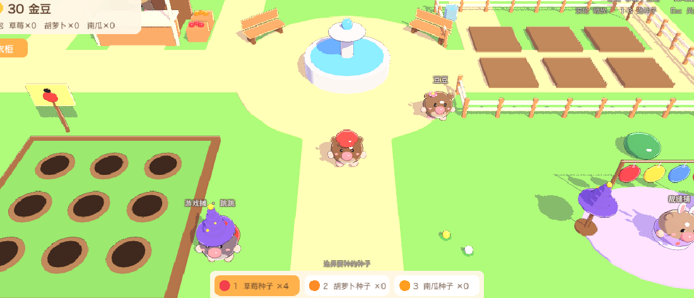
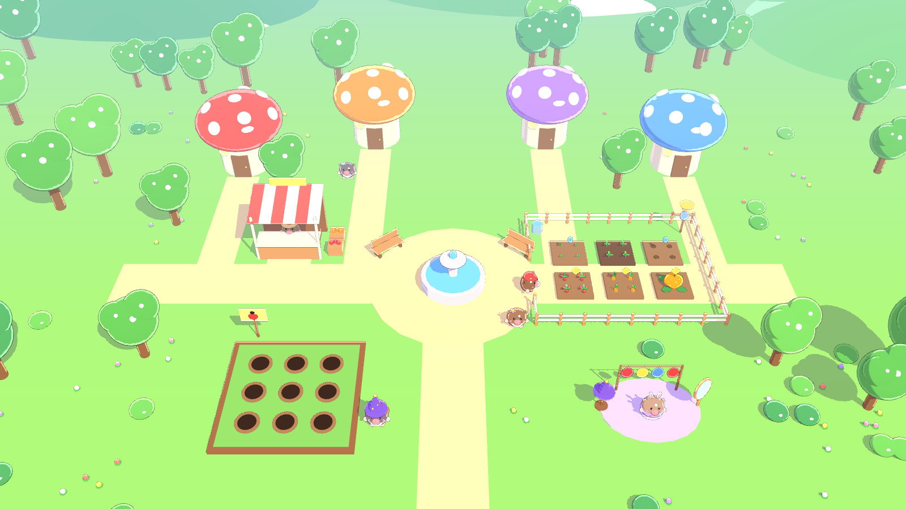
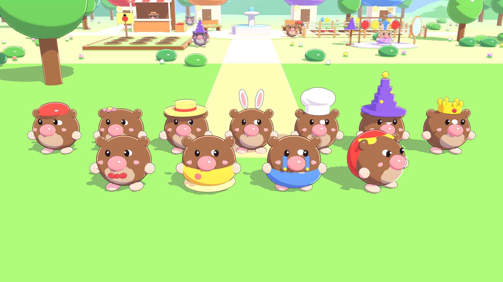
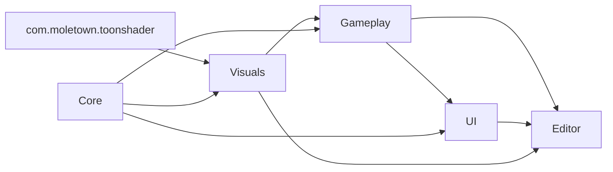

# 鼹鼠小镇 MoleTown（Unity 三渲二）

一个摩尔庄园风格的休闲小镇游戏原型，用 Unity 6 + URP 制作，画面采用自研的三渲二（卡通渲染）着色器。
所有模型都由基础几何体在代码里拼出来，没有使用外部美术资源；场景也由生成器一键搭建。



| 小镇全景 | 全部帽子和衣服 |
| --- | --- |
|  |  |

## 玩法

- **种地**：点田地种下种子 → 浇水 → 长大一个阶段后再浇水 → 成熟收获。草莓 18 秒、胡萝卜 30 秒、南瓜 45 秒成熟。关掉游戏后作物会继续长（每次浇水最多长一个阶段）。
- **杂货铺**（阿土）：买种子、卖作物。
- **裁缝铺**（小棉）/ 左上角「衣柜」：8 种帽子、5 套衣服，点一下试穿，没有的会先买下。
- **捉虫大作战**（跳跳）：30 秒里敲地洞冒出的瓢虫，红色 +1、金色 +3，敲到鼹鼠宝宝 −2；每分换 1 金豆，记录最高分。
- **聊天**：点村民豆豆、可可会冒对话气泡。
- 进度自动保存（PlayerPrefs）。

| 操作 | 说明 |
| --- | --- |
| 左键 | 寻路移动；点田地、NPC 会走过去互动 |
| WASD | 直接移动 |
| 滚轮 | 缩放镜头 |
| 1 / 2 / 3 | 切换要种的种子 |
| Esc | 关闭窗口 |

## 运行

1. 用 **Unity 6000.3**（Unity 6.3 LTS）打开本目录。
2. 打开场景 `Assets/MoleTown/Scenes/MoleTown.unity`，点 Play。
3. 想重新生成场景：菜单 **Tools → MoleTown → Build Scene**；清除存档：**Tools → MoleTown → Clear Save**。

## 三渲二着色器

位于独立的 UPM 包 [`Packages/com.moletown.toonshader`](Packages/com.moletown.toonshader)，可以直接拷到其他 URP 项目使用，详见包内 README。

- 色阶光照（硬边 / Ramp 贴图），投影也做色阶化，阴影带冷色调
- 硬边高光（HDR，可配合 Bloom 产生闪光）
- **屏幕空间深度边缘光**：采样深度图找轮廓，平面在掠射角也不会整面发白；关掉时退回菲涅尔边缘光
- 背面外扩描边：近处固定像素宽度、远处随透视变细；支持把平滑法线烘进切线，立方体等硬边模型的描边不会断开
- 附加光源色阶化，支持 Forward 与 Forward+（Cluster Light Loop）
- 完整的 ShadowCaster / DepthOnly / DepthNormals Pass，兼容深度预渲染与 SSAO
- 场景配有轻度后期：Bloom、饱和度/对比度、暗角

## 工程结构

```
Assets/MoleTown/
├── Core/        纯数据与规则：作物、服装、背包、衣柜、存档、计时、小游戏计分；IGameUI / IMiniGame 接口
├── Visuals/     基础几何体拼模型：卡通材质缓存、平滑法线网格、鼹鼠和服装模型
├── Gameplay/    游戏逻辑组件：角色控制、镜头、农田、NPC、捉虫小游戏、GameManager
├── UI/          运行时用代码搭建的 UGUI 界面（HUD、商店、衣柜、小游戏面板）
├── Editor/      场景生成器 MoleTownBuilder
├── Tests/       EditMode（规则逻辑）与 PlayMode（加载真实场景跑流程）测试
├── Scenes/      MoleTown.unity
└── Generated/   生成器产出的材质、网格、NavMesh、后期配置
Packages/com.moletown.toonshader/   三渲二着色器包（Runtime + Editor）
```

每个目录是一个独立的程序集（asmdef），依赖关系单向：



玩法层不直接引用界面层：界面通过 `Core/IGameUI.cs` 中的 `IGameUI` 接口注册到 `GameUI.Current`，玩法层只调用这个接口；小游戏实现 `IMiniGame`，界面据此显示规则和计分，新增小游戏不用改界面代码。

## 测试

在 Unity 的 Test Runner 里运行，或用命令行（先关掉已打开该项目的编辑器）：

```bash
Unity -batchmode -projectPath . -runTests -testPlatform EditMode -testResults results-EditMode.xml
```

```bash
Unity -batchmode -projectPath . -runTests -testPlatform PlayMode -testResults results-PlayMode.xml
```

PlayMode 测试使用独立的存档 key，不会影响本地游戏进度。

## 说明

游戏里的地名、角色名和货币（鼹鼠小镇、阿土、小棉、金豆等）都是原创，没有使用《摩尔庄园》的名称与美术。

## 许可证

[MIT](LICENSE)
